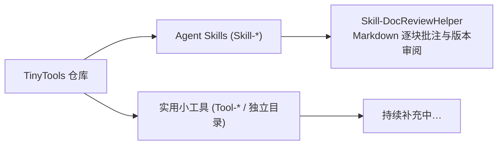
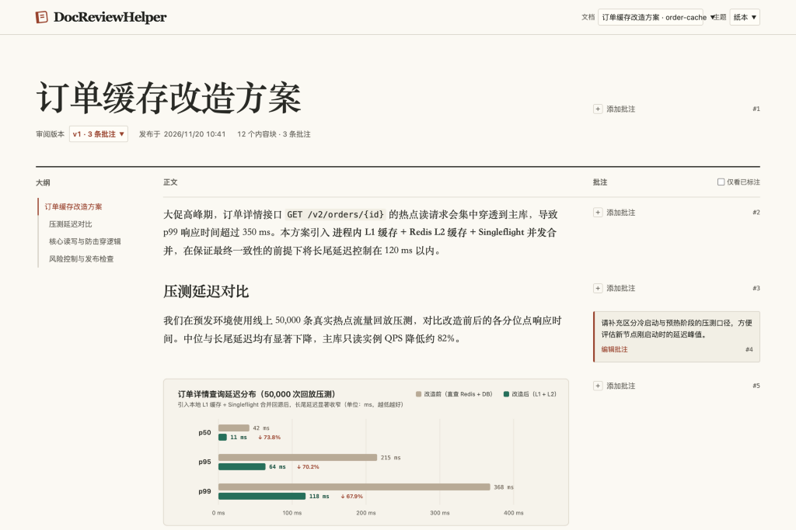

# TinyTools

个人轻量级 **Agent Skills** 与**实用小工具**合集仓库。

这里用于持续收集和沉淀在日常开发、文档协作与效率提升过程中制作的小型 Skill、命令行脚本及本地工具。每个子项目保持**独立目录、轻量低依赖、开箱即用**，方便随时复用或直接交付给 AI Agent 安装调用。

---

## 🗺️ 工具与技能地图（Map）

| 名称 | 类型 | 目录 | 简介 | 依赖 | 状态 |
| :--- | :---: | :--- | :--- | :--- | :---: |
| **DocReviewHelper 文档审阅** | `Skill` | [Skill-DocReviewHelper/](Skill-DocReviewHelper/) | 将 AI 生成的 Markdown 文档发布为可逐块批注、支持多版本回溯与主题切换的本机 HTML 审阅页（[使用文档](Skill-DocReviewHelper/README.md) · [安装包](Skill-DocReviewHelper/dist/doc-review-helper.zip)） | Python 3.9+ | ✅ 可用 |

### 仓库结构图

---

## ✨ 已收录项目速览

### [Skill-DocReviewHelper](Skill-DocReviewHelper/README.md) — Markdown 逐块批注审阅页

- **适用场景**：与 Codex、Claude Code 等 AI Agent 协作撰写技术方案、复盘与设计文档时，在浏览器中像评审稿件一样逐块写下批注，再让 Agent 按批注定向修订并发布新版本。
- **核心亮点**：零外部依赖离线运行、逐块批注与永久锚点、多版本对比/返查/恢复、内置「纸本 / 潮汐 / 夜读」三套阅读主题。
- **快速入口**：[查看完整 README](Skill-DocReviewHelper/README.md) · [安装说明](Skill-DocReviewHelper/INSTALL.md) · [下载分发包 doc-review-helper.zip](Skill-DocReviewHelper/dist/doc-review-helper.zip)

---

## 📁 目录约定与后续扩展

为了便于长期维护与快速检索，后续新增项目遵循以下简单约定：

1. **命名规范**：
   - `Skill-<Name>/`：面向 AI Agent 的标准 Skill（包含 `SKILL.md`、`INSTALL.md` 及对应脚本/资源）。
   - `Tool-<Name>/`（或简明功能目录名）：独立的命令行工具、脚本或本地小应用。
2. **独立自洽**：每个子目录自带 `README.md` 说明用途、依赖与用法，不跨目录强耦合。
3. **同步地图**：每新增一个 Skill 或工具后，在上方「**工具与技能地图（Map）**」表格中补充一行入口即可。
