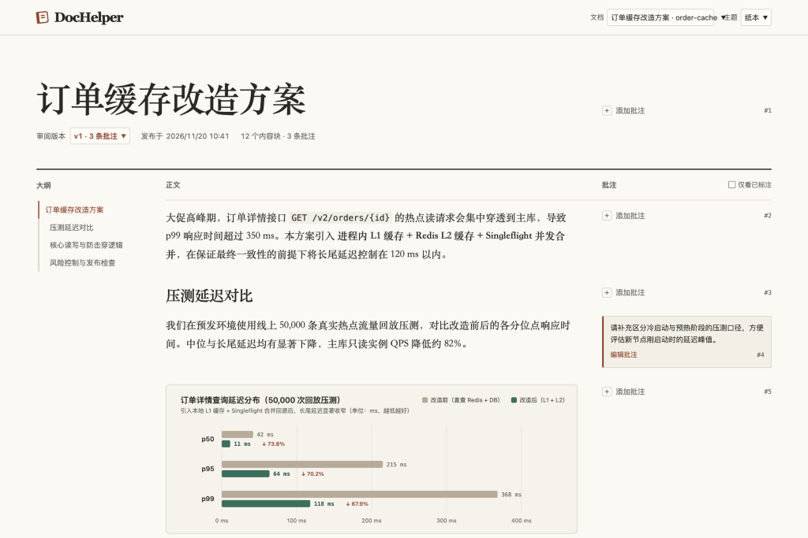
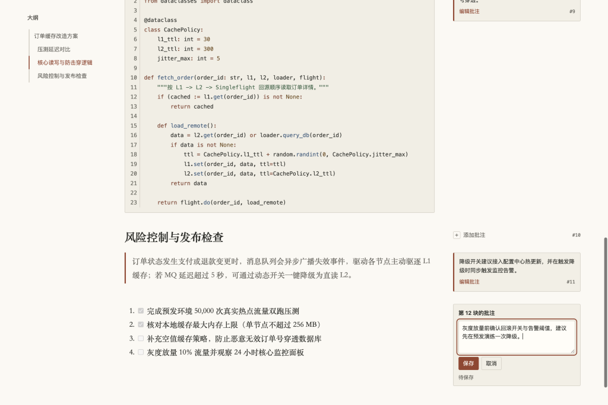
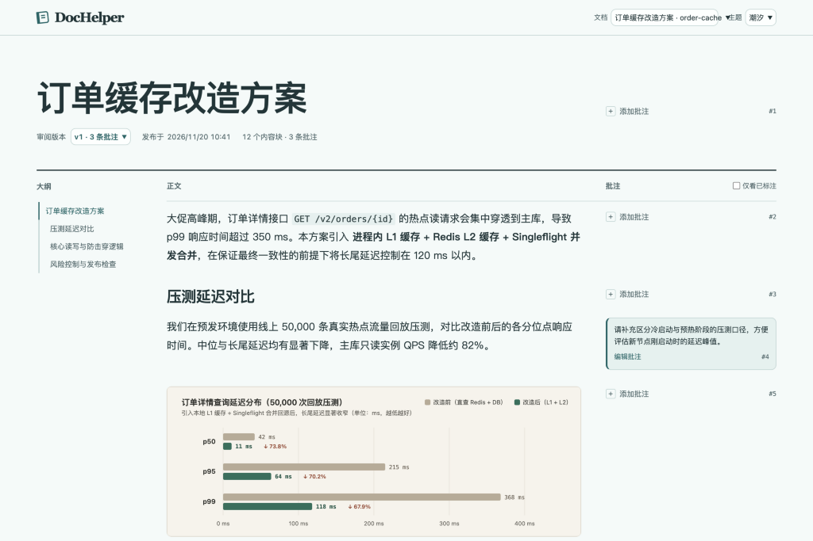
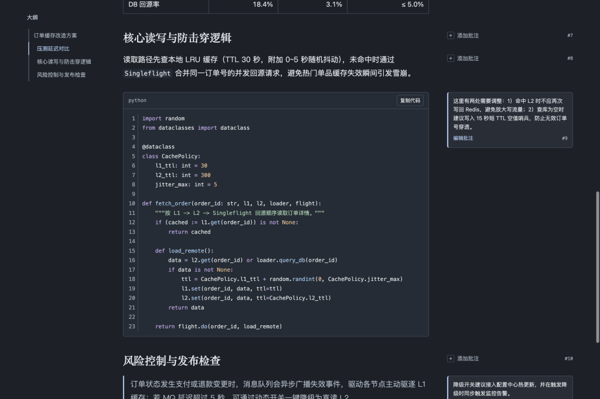
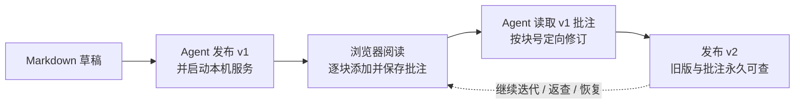

# DocHelper 文档审阅

> 把 AI 生成的 Markdown 文档变成**可逐块批注、支持多版本回溯**的本机 HTML 审阅页。

在与 AI Agent 协作撰写技术方案、架构设计或复盘报告时，直接在聊天框里口头描述“第三段第二句改一下”“代码块里补充空值处理”往往效率很低，且多轮修改后很难回溯上下文。

**DocHelper** 为项目工作目录提供一套轻量、完全离线的文档审阅工作流：你可以在网页中像评审稿件一样，在任意段落、图表、表格或代码块旁写下批注；再让 Agent 按批注逐条修订并发布新版本，整个迭代过程清晰留痕。



---

## 核心特性

- **逐块批注与精准定位**：自动按标题、段落、配图、表格、代码块、引用和列表切分内容块，每块提供独立批注区与永久锚点（`#block-N`）。支持 `Ctrl / ⌘ + Enter` 快捷保存、多窗口并发编辑冲突检测，以及「仅看已标注」一键筛选。
- **多版本迭代与历史回溯**：每次发布生成独立版本，旧版正文、收录配图与批注永久保留。支持下拉切换任意历史版本、按关键词跨版本返查正文与批注（`find`），以及将旧版无损恢复为新版本（`restore`）。
- **专注阅读的排版体验**：内置滚动同步的左侧文档大纲、完整表格与任务清单渲染、带语法高亮/行号/一键复制的代码块，并预置「纸本」「潮汐」「夜读」三套主题，同时支持按项目自定义 CSS 主题。
- **零外部依赖、本地安全运行**：仅依赖 Python 3.9+ 标准库（`sqlite3`、`http.server`），前端资源全部随包内置、无需联网；服务仅监听本机回环地址并启用严格 CSP 防护，所有审阅数据集中存储在工作目录的 `.dochelper/reviews.sqlite3`，相同内容块与图片跨版本自动去重复用。

---

## 界面预览

### 逐块批注与代码审阅

阅读长文档时，左侧大纲会随滚动自动高亮当前章节；点击任意内容块右侧的「添加批注」即可原地编写意见。支持语法高亮、行号定位、引用块、任务清单以及未保存草稿保护：



### 多套内置阅读主题

页面右上角可随时切换内置风格，同一版本的批注在所有主题下共享。除上方展示的默认**纸本（`folio`）**外，还内置了清爽冷色的**潮汐（`tide`）**与低眩光深色的**夜读（`midnight`）**：

| 潮汐（`tide`）· 清爽无衬线 | 夜读（`midnight`）· 深色代码高亮 |
| :---: | :---: |
|  |  |

如需为当前项目定制配色或字体，可在工作目录的 `.dochelper/themes/` 下新增 CSS 文件，详见 [自定义审阅风格指南](references/themes.md)。

---

## 安装配置（交给 Agent 一键完成）

DocHelper 以 Agent Skill 形式分发，安装与运行只需 **Python 3.9+**（含标准库 `sqlite3`）和现代浏览器，全程可离线完成。

将安装包 [dist/doc-helper.zip](dist/doc-helper.zip) 作为附件发给目标 Agent，并发送下面这段提示（如果目标 Agent 可以直接访问本地源码，也可以直接附上 `Skill-DocHelper` 目录路径）：

> 请读取我提供的 DocHelper 压缩包或源码目录中的 INSTALL.md，在你当前运行的 agent 环境里为当前用户安装配置 DocHelper，验证它可以调用，并告诉我在这个环境中该怎样发起第一次文档审阅。

> **提示**：若只想为单个项目启用 DocHelper，可在上述消息中额外说明项目路径与“仅安装到该项目”。

### 主流宿主安装位置参考

| Agent 宿主 | 用户级技能目录 | 项目级技能目录 | 显式调用方式 |
| :--- | :--- | :--- | :--- |
| **Codex** | `~/.agents/skills/` | `<项目>/.agents/skills/` | `$doc-helper` |
| **Claude Code** | `~/.claude/skills/` | `<项目>/.claude/skills/` | `/doc-helper` |

压缩包顶层包含 `INSTALL.md` 与完整的 `doc-helper/` 技能目录。其他兼容 Agent Skills 的宿主及详细验收步骤，请参阅 [安装与验证说明](INSTALL.md)。

---

## 使用流程



以 **Codex** 为例（在 Claude Code 中将 `$doc-helper` 替换为 `/doc-helper`），在待审文档所属项目的对话中完成一轮审阅只需三步：

### 1. 发布文档并获取审阅链接

> `$doc-helper` 请把 `docs/design.md` 发布成审阅页，文档 ID 用 `design`，给我本机阅读链接。

Agent 会在当前工作目录将文档入库，启动本机审阅服务并返回类似 `http://127.0.0.1:8765/?doc=design&version=1` 的链接。

### 2. 在浏览器中阅读与逐块批注

1. 打开本机链接，通过左侧**大纲**快速跳转到目标章节。
2. 在需要修改的段落、图表、表格或代码块右侧点击 **「添加批注」**，输入修改意见后点击 **「保存」**（或按 `Ctrl / ⌘ + Enter`）。
3. 批注较多时，可勾选批注栏顶部的 **「仅看已标注」** 快速复核所有意见。

### 3. 让 Agent 按批注修订并迭代新版

回到同一项目的对话中发送：

> `$doc-helper` 请根据 `design` 第 1 版已保存的批注修改文档，发布第 2 版，并说明改了哪些块。

Agent 会读取第 1 版的所有批注与原文块，逐条修订并发布为第 2 版：
- 新版本默认从空白批注开始，方便展开下一轮审阅。
- 通过标题下方的 **「审阅版本」** 下拉框可随时切回旧版，完整查看历史原文和当时的批注。
- 也可以随时请 Agent **返查关键词**（“帮我查一下‘冷启动’在哪些版本出现过”）或**恢复旧版**（“把第 1 版恢复发布为第 3 版”）。

---

## 命令行速查与本地试用

日常使用中由 Agent 自动调用命令行；如果你希望在终端里手工试用或调试，可以直接运行 `scripts/dochelper.py`（命令需在**目标文档所在的工作目录**下执行）：

| 命令 | 说明 |
| :--- | :--- |
| `publish <doc> <file> [--title ...] [--base N]` | 将 Markdown 发布为新版本（首版建议 `--base 0` 防止误覆盖） |
| `serve [--port 8765] [--doc <doc>] [--version N] [--theme folio]` | 启动本机审阅服务（端口冲突时可用 `--port 0` 自动分配） |
| `list` | 列出当前工作目录中的所有审阅文档 |
| `history <doc>` | 查看文档的版本列表及各版本已保存批注数 |
| `notes <doc> [--version N]` | 导出指定版本的非空批注与对应原文块（JSON） |
| `source <doc> [--version N] [--pin-images]` | 输出指定版本的 Markdown 原文（`--pin-images` 可锁定库内图片摘要） |
| `find <doc> <query> [--version N]` | 按字面关键词检索正文与批注，返回直达块锚点的路径 |
| `restore <doc> <version> [--base N]` | 将指定历史版本的正文与配图恢复发布为新版本 |

### 用内置示例快速体验

```sh
# 1. 复制内置示例到独立临时目录
mkdir -p /tmp/dochelper-demo
cp examples/search-review.md examples/search-latency.png /tmp/dochelper-demo/
cd /tmp/dochelper-demo

# 2. 发布第 1 版并启动本机审阅页（替换为实际的 dochelper.py 绝对路径）
python3 /path/to/Skill-DocHelper/scripts/dochelper.py publish search-review search-review.md --base 0
python3 /path/to/Skill-DocHelper/scripts/dochelper.py serve --doc search-review --version 1
```

在浏览器中打开终端输出的 `http://127.0.0.1:8765/?doc=search-review&version=1` 即可体验完整审阅界面。

---

## 工作目录与使用注意事项

- **服务生命周期**：阅读和保存批注期间，请保持对应工作目录的本机审阅服务处于运行状态；服务关闭后，在同一工作目录重新启动 `serve`（或让 Agent 重新打开）即可继续查阅。远程开发环境中可将远端回环端口通过私有端口转发映射至本机相同端口。
- **数据存储与去重**：正文、收录配图与各版批注均保存在当前工作目录的 `.dochelper/reviews.sqlite3` 中，不依赖全局数据库；相同内容块与图片在多个版本间自动去重复用。
- **图片与链接规范**：支持工作目录内的本地图片（PNG、JPG、GIF、WebP、SVG），需**单独成段**编写（如 ``）。指向其他本地文档的相对链接在审阅页会以纯文本展示；如需审阅关联文档，建议分别发布为独立文档 ID。
- **主题配置**：启动服务时可用 `--theme midnight` 指定默认主题，或在链接中附加 `theme=tide`。更多样式变量与覆盖规则见 [references/themes.md](references/themes.md)。

---

## 项目结构与维护者指南

```text
Skill-DocHelper/
├── SKILL.md                 # Agent 技能入口与操作规范
├── INSTALL.md               # 给 Agent 的自动安装与验收指南
├── agents/openai.yaml       # Codex 技能元数据与显式调用策略
├── scripts/
│   ├── dochelper.py         # CLI 命令行入口
│   ├── review_server.py     # 本机 HTTP 审阅服务与安全头/API 实现
│   └── review_store.py      # Markdown 分块解析、SQLite 版本库与图片去重存储
├── assets/                  # 随包分发的 HTML / CSS / JS 与内置三套主题
├── references/themes.md     # 自定义工作区主题文档
├── examples/                # 内置快速试用示例文档与配图
├── docs/images/             # README 界面预览截图
├── tests/test_store.py      # 单元测试
├── tools/package_skill.py   # 分发包打包脚本
└── dist/doc-helper.zip      # 可直接交付给 Agent 的成品安装包
```

### 运行测试与重新打包

修改源码后，可在 `Skill-DocHelper` 目录运行单元测试并重新生成分发包 `dist/doc-helper.zip`（Windows 可将 `python3` 替换为 `py -3`）：

```sh
# 运行单元测试
python3 -m unittest discover -s tests

# 重新生成 dist/doc-helper.zip
python3 tools/package_skill.py
```
