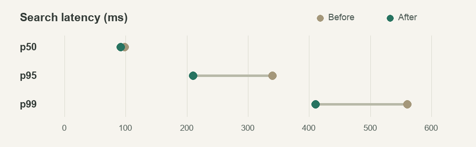

# 搜索响应时间复盘

本次示例用同一组查询回放两次，比较索引调整前后的响应时间。中位数仅缩短了 6 毫秒，较慢的那批请求改善更明显。

## 哪些请求变快了

两次回放各包含 10,000 次查询。p95 从 340 毫秒降至 210 毫秒，意味着新版有 95% 的请求在 210 毫秒内完成。



| 分位点 | 调整前 | 调整后 |
| :--- | ---: | ---: |
| p50 | 98 ms | 92 ms |
| p95 | 340 ms | 210 ms |
| p99 | 560 ms | 410 ms |

## 计算口径

回放脚本使用最近秩法计算分位数。下面的函数接受非空样本和介于 0 与 1 之间的分位值，含右端点。

```python
from math import ceil

def percentile(samples, q):
    if not samples or not 0 < q <= 1:
        raise ValueError("需要非空样本和有效分位值")
    ordered = sorted(samples)
    return ordered[ceil(len(ordered) * q) - 1]
```

## 下一轮验证

这组数据来自预热后的索引。下一轮将单独记录冷启动查询，检查上线初期的响应时间是否也有改善。
